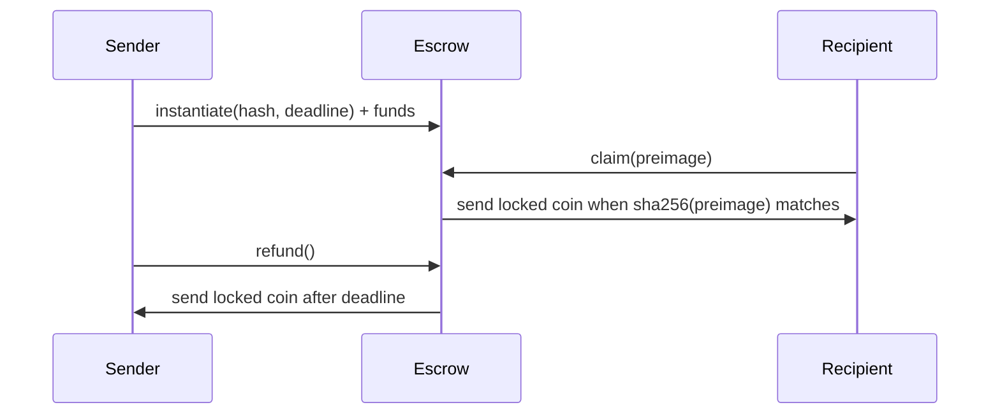

# Hashlock Escrow

This example shows a simple hash time locked contract for native Cosmos
tokens. A sender locks one coin in the contract for a recipient. The recipient
can claim before the deadline by revealing the preimage whose SHA-256 hash was
stored at instantiation. If the deadline passes first, the sender can refund the
locked funds.

## Flow

1. Sender chooses a secret preimage, for example `open sesame`.
2. Sender computes `sha256(preimage)` off chain.
3. Sender instantiates the contract with:
   - the recipient address,
   - the hash,
   - the claim deadline,
   - exactly one native coin in `funds`.
4. Recipient executes `claim` with the preimage before the deadline.
5. If the recipient does not claim in time, sender executes `refund`.



## Messages

Instantiate:

```json
{
  "recipient": "cosmos1...",
  "hash": "<base64 sha256 digest>",
  "deadline": "1700000000000000000"
}
```

`deadline` is a CosmWasm `Timestamp`, encoded as nanoseconds since Unix epoch.

Execute claim:

```json
{
  "claim": {
    "preimage": "<base64 preimage>"
  }
}
```

Execute refund:

```json
{
  "refund": {}
}
```

Query escrow:

```json
{
  "escrow": {}
}
```

## Design Notes

- The contract stores only the hash, never the preimage before claim.
- The locked asset is one native coin, keeping the example focused on hashlock
  logic.
- The deadline comparison uses block time. Claims must arrive strictly before
  the deadline; refunds require the deadline to have passed.
- The escrow closes permanently after either a successful claim or refund.
